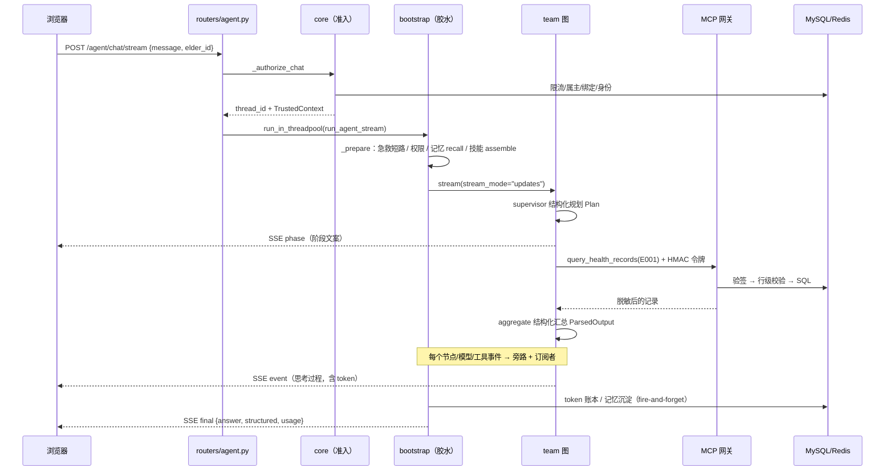

# 养老智能体 · 整体链路架构

> 本文描述**当前代码的真实形态**（含本轮接通的四条链路），不是设计意图。
> 路径相对 `练手agent/`，`fastap2/` 为后端、`allagent2/` 为智能体库。

---

## 一、一张图看全

```
┌───────────────────────── 浏览器 ──────────────────────────┐
│  login.html        chat.html              admin.html       │
│  登录/注册          对话 + 思考面板         6 个管理页        │
│      └──────────── /static/{app.css,common.js} ───────────┘
└──────────────────────────┬─────────────────────────────────┘
                           │ HTTP / SSE（Bearer JWT）
┌──────────────────────────▼─────────────────────────────────┐
│ ① 入口  fastap2/main.py                                     │
│    lifespan: init_db → 注册 allagent2 包路径 → metrics.install│
│    中间件: HTTP 耗时指标；挂载 /metrics、/static             │
└──────────────────────────┬─────────────────────────────────┘
                           ▼
┌────────────────────────────────────────────────────────────┐
│ ② 准入  routers/agent.py::_authorize_chat（7 道闸，零 token）│
│    限流(Redis) → 注入扫描 → 敏感意图 → 标识符格式            │
│    → 线程属主(conversation_owner) → 绑定关系 → 可信身份      │
│    身份写 Redis identity:{id}，TTL 900s，perm_version 可撤销 │
└──────────────────────────┬─────────────────────────────────┘
                           ▼ run_in_threadpool（contextvars 自动传播）
┌────────────────────────────────────────────────────────────┐
│ ③ 胶水层  fastap2/agent_bridge/bootstrap.py                 │
│    bootstrap(): env → sys.path → MCP 工具 → checkpointer     │
│                 → 身份/中断/用户 注入 → 编译图                │
│    _prepare(): 急救短路 → 权限上下文 → 初始 state            │
│                 → 记忆召回 → 技能装配                        │
│    _finalize(): 结构化提取 → 兜底 → token 账本 → 记忆沉淀     │
└──────┬─────────────────────────────────┬───────────────────┘
       │ 注入式解耦（allagent2 不 import fastap2）
       ▼
┌────────────────────────────────────────────────────────────┐
│ ④ 图  allagent2/agent/                                      │
│    team（当前生产）  supervisor → Send 扇出 → aggregate      │
│                      ├ health    (create_agent 子图)        │
│                      ├ knowledge (create_agent 子图)        │
│                      └ life      (create_agent 子图)        │
│    react（手写循环） guard → think ⇄ act → observe → finalize│
│    守卫  middleware.py（身份/越权/PII/急救/槽位）            │
│    事件  observe.py（node/llm/tool 事件 → 旁路 + SSE 订阅）  │
└──────┬─────────────────────────────────┬───────────────────┘
       │ 工具调用（HMAC 能力令牌）          │ 记忆/技能/检索（进程内）
       ▼                                 ▼
┌──────────────────────────┐   ┌──────────────────────────────┐
│ ⑤ MCP 进程  8001/8002     │   │ ⑦ 智能体内部能力              │
│    elder: 档案/健康记录     │   │  session/  四层记忆           │
│    life : 天气/计算/BMI    │   │  rag/      三路召回+重排       │
│    网关: 验签 → 白名单      │   │  skills/   技能渲染           │
│          → 行级 → SQL       │   │  ingestion/ 文档摄取           │
│          → 脱敏 → 审计      │   └──────────────────────────────┘
└──────────┬───────────────┘
           ▼
┌────────────────────────────────────────────────────────────┐
│ ⑥ 存储                                                      │
│    MySQL  用户/老人/健康/绑定/会话属主/审计/技能/记忆         │
│    Redis  checkpoint · 身份 · 限流 · 幂等 · 中断标记          │
│    Chroma 知识库向量 · 记忆向量 · 上传文档向量                │
└────────────────────────────────────────────────────────────┘

旁路（不阻塞主链）：
  事件流 → state.trace / trace_team.jsonl / SSE event 帧 → 前端「思考过程」
  指标   → emit_event → meter() → Prometheus /metrics
  账本   → token_usage.jsonl（按模型分桶）
  审计   → MySQL audit_log（允许/拒绝双写）
```

---

## 二、一次对话的时序



---

## 三、模块地图

| 层 | 目录 | 关键文件 | 坏了会怎样 |
|---|---|---|---|
| 入口 | `fastap2/` | `main.py` | 服务起不来 |
| 准入 | `fastap2/core/` | `acl.py` `identity.py` `rate_limit.py` `audit.py` | 越权或全站 403 |
| 路由 | `fastap2/routers/` | `agent.py` `files.py` `health.py` `acl.py` `audit.py` | 该功能 404 |
| 胶水 | `fastap2/agent_bridge/` | `bootstrap.py` `mcp_runtime.py` `middleware.py` | 图编译失败 → `/chat` 503 |
| 图 | `allagent2/agent/` | `team.py` `react_loop.py` `middleware.py` `observe.py` | 回答质量或可观测性下降 |
| 工具进程 | `fastap2/mcp_servers/` | `data_gateway.py` `elder_server.py` `life_server.py` | 该服务工具缺失（链路仍可跑） |
| 记忆 | `allagent2/session/` | `recall.py` `reflect.py` `store.py` `scoring.py` | 退化为"无记忆" |
| 检索 | `allagent2/rag/` | `rag.py` `fusion.py` `rerank.py` `hyde.py` | 退化为纯词法 |
| 摄取 | `allagent2/ingestion/` | `pipeline.py` `parsers/` `index_store.py` | 上传文件搜不到 |
| 技能 | `allagent2/skills/` + `fastap2/core/skill_service.py` | `registry.py` | 技能对模型零影响 |
| 旁路 | `fastap2/observability/` + `allagent2/guance/` | `metrics.py` `token_accounting.py` | 无指标，不影响回答 |

---

## 四、本轮接通的四条链路

| 链路 | 之前 | 现在 |
|---|---|---|
| **技能 → prompt** | `render_block()` 零调用 | `bootstrap._prepare` 装配 → `skills_block` → 单图/多图各自拼进 prompt |
| **上传 → 检索** | 只存文本，`ingest_file` 零调用 | 上传即摄取（续线程池）→ 向量入库（带 acl）→ `search_knowledge_base` 合并个人文档 |
| **HyDE 第三路** | `fusion.fuse()` 只收两路 | 三路融合 + `RAGConfig.HYDE_*` + `search()` 接第三路（无 key 自动退化） |
| **思考过程** | 事件只在旁路文件里 | `observe` 订阅 → SSE `event` 帧 → 前端面板（含每次 token） |

### 关键不变量

1. **依赖方向单向**：`allagent2` 永不 import `fastap2`；反向能力全部走注入
   （`set_identity_validator` / `set_abort_check` / `set_user_provider` / `metrics.set_sink`）。
2. **模型可替换**：换模型只改 `OPENAI_BASE_URL` / `OPENAI_MODEL`，零代码改动。
3. **存储分层**：MySQL 是事实源，Redis 是快状态（挂了降级），Chroma 可重建。
4. **失败要有出口**：每个旁路（记忆/检索/技能/指标/审计）失败都降级，不挡回答；
   事实源（MySQL）失败才报错。
